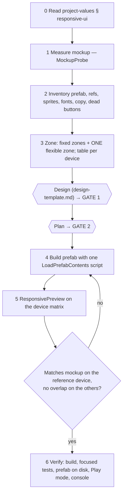

# Responsive UI

Build uGUI screens that match a mockup on the reference screen and stay correct on every aspect ratio.
Measure the mockup, split the screen into fixed zones and one flexible zone, build the prefab by script,
and prove it with renders on a fixed device matrix.

**This skill works inside the project's task gates.** Its measurements and zoning go into the design doc
(Gate 1, use [design-template.md](design-template.md)); its build and verification steps go into the plan
(Gate 2). It never replaces them.

## Requires

| Need | Where |
|---|---|
| `com.quang.ui` ≥ 0.10.0 | `SafeAreaFitter`, `UniformScaleFitter`, `CanvasScalerMath` (runtime); `MockupProbe`, `ResponsivePreview`, `PreviewDevice` (Editor, `Quang.UI.Editor`) |
| `com.quang.utilities` ≥ 0.3.0 | `SafeAreaMath` — the one safe-area rule for UI **and** world layout |
| Unity MCP | `execute_code`, `run_tests`, `read_console`, `manage_editor` (see `pkg-framework-unity-mcp.md`) |

## Project values

Read `.claude/rules/project-values.md` § `responsive-ui`. Keys below appear as `<KEY>`.
If the section is missing, fill it from [project-values-template.md](project-values-template.md) — read the
values from the project (CanvasScaler, folders, fonts) and ask the user only what the project cannot tell you.

| Key | Meaning |
|---|---|
| `<UI_SCALER_PREFAB>` | Prefab holding the project's `CanvasScaler` |
| `<CANVAS_REFERENCE>`, `<CANVAS_MATCH>` | Reference resolution and Match Width Or Height |
| `<MOCKUP_DIR>`, `<MOCKUP_TO_CANVAS>` | Mockup folder; canvas units per mockup pixel |
| `<UI_SPRITES_DIR>` | Sliced sprites, icons — check here before generating anything |
| `<TITLE_FONT>`, `<BODY_FONT>` | TMP font assets |
| `<CANVAS_DIR>`, `<CANVAS_ASSEMBLY>` | Where canvas prefabs live; assembly of the canvas scripts (for `System.Type.GetType`) |
| `<PREVIEW_DEVICES>` | `default` (`PreviewDevice.Defaults`) or a project list |

## Canvas size — compute it, never assume it

`CanvasScalerMath.CanvasSize(screen, <CANVAS_REFERENCE>, <CANVAS_MATCH>)`:
`scale = 2^lerp(log2(sw/rw), log2(sh/rh), match)`, canvas = screen / scale.

- **match 0** (width): canvas width is always the reference width; only height changes. Tablets (3:4) get the
  **shortest** canvas — vertical space is the constraint.
- **match 0.5**: tall phones get narrower *and* taller; tablets get wider and shorter.
- **match 1** (height): canvas height is fixed; width changes — horizontal space is the constraint.

Write the five canvas sizes of `<PREVIEW_DEVICES>` into the design before zoning.

## Workflow

1. **Measure, don't eyeball.** `MockupProbe.MeasureRows(mockup, <MOCKUP_TO_CANVAS>, bgPixel)` gives every content
   band in canvas units. Read colors/sizes inside a band with a targeted sample if needed. Every element in the
   design is written as canvas units.
2. **Inventory** (snippets.md § 2): hierarchy with components, TMP settings and margins; every `[SerializeField]`
   the canvas script uses (they must survive the rebuild); sprites needed vs available and their 9-slice borders;
   fonts. Also list, as **questions for Gate 1**: copy language (mockup vs current prefab), mockup elements with no
   feature behind them (hide or hook?), ad banner slot.
3. **Zone the screen** (rules below). Put a table of the flexible zone's available height and resulting scale
   per device in the design, plus the node tree as Mermaid.
4. **Build** with one `LoadPrefabContents` script (snippets.md § 3). Keep it in `execute_code` history to replay.
5. **Render** with `ResponsivePreview.Render` (snippets.md § 4) and read the PNGs next to the mockup. Iterate on
   numbers in the build script, not by hand in Prefab Mode.
6. **Verify** (checklist below).

## Layout rules

- **Background outside, content inside.** Full-bleed background and decoration stay stretched on the canvas root;
  everything interactive goes under a stretched `SafeArea` node with `Quang.UI.SafeAreaFitter`.
- **One safe-area rule.** World/layout code that must line up with the HUD reads `SafeAreaMath.Current()`; never
  write a second safe-area calculation in a game.
- **Fixed zones for what is tapped or read** — top bar, buttons, panels, banner slot: mockup size in canvas units,
  anchored to the edge they belong to (top-stretch, bottom-stretch, corner). Same size on every device.
- **Exactly one flexible zone** absorbs the aspect difference — usually the logo / hero art. Stretch it between the
  fixed zones with offsets.
  - Single image → child with `AspectRatioFitter` **Fit In Parent** at the sprite's ratio.
  - Several elements (title + art + props) → a fixed-size content node with `Quang.UI.UniformScaleFitter`
    (`designSize`, `maxScale` 1). Lay the children out at design size.
  - **Design size = content bounds + padding to the neighbouring fixed zone.** Bounds alone make content touch the
    buttons once it scales down. Always check the shortest canvas in the matrix.
- **No centre-relative magic numbers** (`y: +190` from centre). They break on tall phones and tablets.
- **Group the bottom cluster** (secondary buttons + main button) in one fixed-size group anchored bottom-centre.
- **Banner slot:** reserve its height at the bottom of `SafeArea`; let its colour band extend below
  (child stretched with `offsetMin.y = -400`) so it reaches the screen edge under the home indicator.
- **Content that bleeds** (belt, ribbon) inside a scaled node: make it much wider than the canvas (e.g. 1000)
  so it still covers the width at the smallest scale.
- **9-slice** every sprite drawn at a ratio other than its native one (`spriteBorder` + Full Rect, `Image.Type = Sliced`).
- **Icon + text rows:** `HorizontalLayoutGroup` (control width on, force expand off) + `LayoutElement` on the icon.
- **Values that change length** (gold, score): the container gets `ContentSizeFitter` (horizontal preferred) +
  `HorizontalLayoutGroup`; never a fixed width that the number can overflow.
- **Tinted icons:** tint the white variant; tinting a dark (ink) variant gives a dark colour.
- **TMP:** auto-size off, `margin = 0`, word wrap off, alignment `CenterGeoAligned` for centred labels.
- **Tiled patterns:** `Image.Type = Tiled`, size the tile with `pixelsPerUnitMultiplier` (native height / wanted height).

## Verification checklist

- [ ] `dotnet build` every touched assembly (`pkg-framework-compile-verification.md`); `read_console` clean.
- [ ] `ResponsivePreview` on `<PREVIEW_DEVICES>`: reference device matches the mockup (positions/sizes within a few
      %), the others have no overlap, text does not overflow, bleed content covers the width.
- [ ] Canvas script refs point to the right objects (`SerializedObject` read-back, snippets.md § 5).
- [ ] Focused tests for new logic (`pkg-framework-focused-test-runs.md`).
- [ ] **Re-check the prefab on disk after running tests.**
- [ ] Play mode from the boot scene: screen opens, values display, every button does what it should. Canvas
      transitions are animated — re-check state on a later call before calling something broken.
- [ ] Device Simulator with a notched iPhone for a final human look.
- [ ] Commit only intended files; leave TMP font-asset atlas diffs out.

## Pitfalls

| Symptom | Cause | Fix |
|---|---|---|
| Prefab reverted after tests | An open Prefab Mode stage with old content was saved when the test runner started | Close Prefab Mode before scripting; re-check the file after tests |
| Flexible content touches the buttons on 16:9 / tablet | Design size = content bounds, no padding | Add padding to `designSize`; re-render the shortest canvas |
| Number overlaps the `+` button | Fixed-width pill | `ContentSizeFitter` + layout group |
| Text sits low in its box | Template text prefab carries a margin | `margin = Vector4.zero` |
| Text not centred next to an icon | Font metrics with `Center` | `CenterGeoAligned` |
| Outline/face colour wrong at runtime | A font-material component overrides the material in `Start` | Disable it on texts that use a styled material |
| Corners stretched | Off-ratio sprite without borders | 9-slice on the importer |
| Inset wrong only in the Editor | Game view reports the simulated device's safe area for a smaller view | Use `SafeAreaFitter` / `SafeAreaMath` (they treat it as no inset) |
| Prefab dirty every frame | `[ExecuteAlways]` component writes the same value | Write only when the value changes (`UniformScaleFitter` does) |
| "Multiple Unity instances" from MCP | Two editors open | `set_active_instance <Name@hash>` first |
| `dotnet build` misses a package type | Unity does not generate csproj for local/git packages | Preferences ▸ External Tools ▸ Generate .csproj for Local/Git packages, then Regenerate |
| Font atlas `.asset` modified after renders | Dynamic atlas filled while rendering | Do not commit these diffs |
| No Python imaging library | — | Measure with `MockupProbe` inside Unity |

## Examples

- Conveyor Unjam Home (390×844, match 0, StyleA mockup ÷3): `Docs/designs/2026-11-12-home-ui-mockup-design.md`.
- BlockDrag Home (1080×1920, match 0.5, mockup ×3): `Docs/designs/2026-11-01-home-canvas-mockup-layout-design.md`.

## Adopting in an existing project

1. List every `com.quang.*` on the release tag that has `com.quang.ui` ≥ 0.10.0.
2. Copy `AI~/skills/responsive-ui` to `.agents/skills/pkg-framework-responsive-ui` (delete any older project-local
   responsive-UI skill).
3. Add `## responsive-ui` to `project-values.md` from the template.
4. Replace project-specific safe-area components with `SafeAreaFitter`; make world code read `SafeAreaMath.Current()`.
5. Render every canvas before and after the switch with `ResponsivePreview` and compare.
