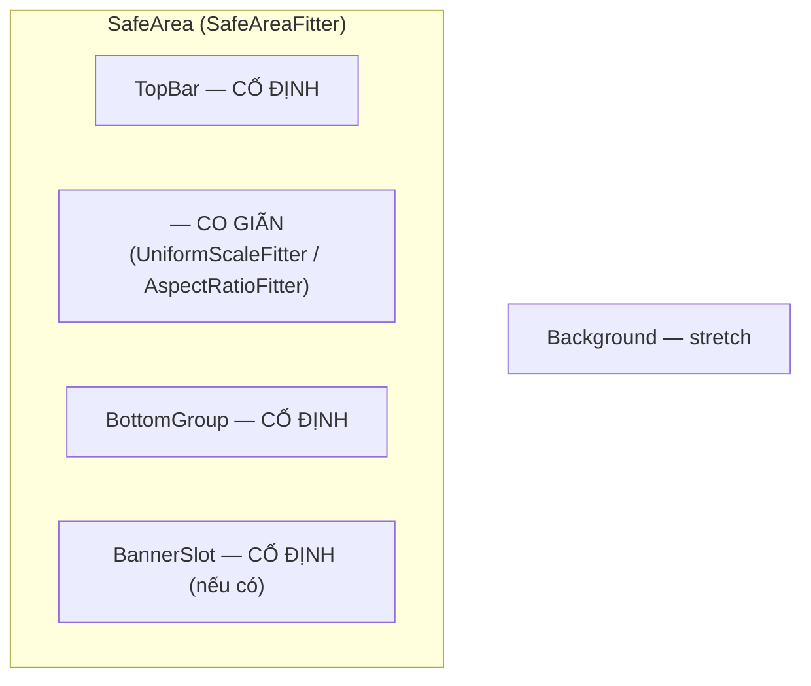

# <Screen> theo mockup — Design

Ngày: YYYY-MM-DD

## Yêu cầu

<Mockup path>, màn hình/prefab cần dựng, yêu cầu responsive.

## Thông số gốc

| Thông số | Giá trị |
|---|---|
| Mockup | <W×H> px → `<MOCKUP_TO_CANVAS>` |
| Canvas Scaler | <ref>, match <m> (`<UI_SCALER_PREFAB>`) |
| Sprite | PPU, 9-slice đã có / cần thêm |
| Font | `<TITLE_FONT>`, `<BODY_FONT>` |
| Safe area | `Quang.UI.SafeAreaFitter` trên node `SafeArea` |

Kích thước canvas (`CanvasScalerMath.CanvasSize`):

| Thiết bị | Pixel | Canvas | Safe area cao | Ghi chú |
|---|---|---|---|---|
| phone-ref | 1170×2532 | | | |
| phone-16x9 | 1080×1920 | | | |
| phone-20x9 | 1080×2400 | | | |
| phone-notch | 1179×2556 | | | |
| tablet-4x3 | 1536×2048 | | | |

## Đo mockup

Kết quả `MockupProbe.MeasureRows` (canvas unit, gốc = mép trên):

| Vùng | y | x | Nội dung, màu, cỡ chữ |
|---|---|---|---|

## Hiện trạng prefab

Cây node + component; các `[SerializeField]` của script canvas (phải giữ); vấn đề hiện tại.

## Thiết kế

### Chia vùng

| Thiết bị | Vùng co giãn khả dụng | Scale |
|---|---|---|

`designSize` = biên nội dung + đệm tới vùng cố định kế bên = <…>.

### Cây node

Mermaid; đánh dấu node giữ lại (có ref) / mới / xoá.

### Thay đổi code

| File | Thay đổi |
|---|---|

## Quyết định cần chốt

1. Ngôn ngữ chữ (mockup vs prefab hiện tại).
2. Phần tử trong mockup chưa có tính năng (ẩn hay móc rỗng).
3. Banner quảng cáo (chừa chỗ hay không).

## Kiểm chứng

- `ResponsivePreview` trên 5 thiết bị, so mockup ở phone-ref.
- Build + test lọc; đọc lại prefab sau test; Play mode; console.
